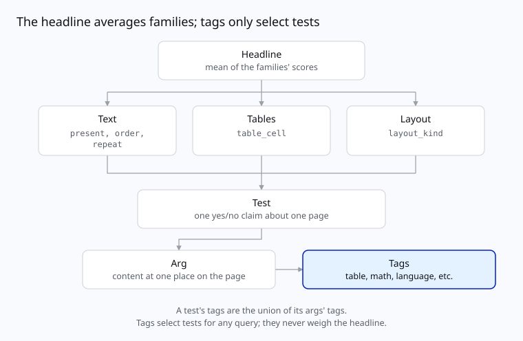

# Omni Parse Bench

[](https://github.com/datalab-to/omni_parse_bench/actions/workflows/test.yml)
[](./pyproject.toml)
[](./LICENSE)
[](./licenses)
[](https://huggingface.co/datasets/datalab-to/omni_parse_bench)


This repository contains a way to run our document-parsing benchmark using our dataset on [HuggingFace](https://huggingface.co/datasets/datalab-to/omni_parse_bench) or your own dataset. It also provides lower-level primitives (score and predict) to run in your own pipelines however you like. Every test is a yes/no question about one page: is this text in the output, in this order, in a table cell under these headings, etc. The README is split up into the following table of contents.


- [The design](#the-design)
- [Install](#install)
- [Run the benchmark](#run-the-benchmark)
- [Score](#score)
- [Predict](#predict)
- [Documentation](#documentation)
- [License](#license)
- [Citation](#citation)

## The design



The headline is the mean of three family scores: text, tables and layout. A family is a group of test
types:

| test type | checks | family |
|---|---|---|
| `present` | this text, number or equation appears | text |
| `order` | text A comes before text B | text |
| `repeat` | this line appears exactly N times | text |
| `table_cell` | this cell sits under these headings and beside these neighbors | tables |
| `layout_kind` | the block holding this line is a heading, text or table | layout |

A test checks one or more args, each of which is the content at one place on the page. Each arg is
tagged:

- structure: `table`, `math`, `form` and `multi_column`;
- rendering: `handwriting`, `tiny`, `rotated` and `degraded`;
- role: `heading`, `caption`, `footnote`, `list`, `code`, `figure` and `header_footer`;
- script: ISO 15924 codes (`Latn`, `Hani`, `Deva`, ...); and
- language: ISO 639-3 codes (`eng`, `fra`, `tha`, ...).

A test's tags are the union of its args' tags. Tags never decide whether a test passes or what the
headline is. It is only used to query tests and rerank. 

## Install

```bash
uv pip install omni-parse-bench                 # score(): no network, no API keys
uv pip install 'omni-parse-bench[harness]'      # + vendor adapters, to predict
uv pip install 'omni-parse-bench[benchmark]'    # + dataset access, to run the benchmark
```

## Run the benchmark

With `[benchmark]` installed, run vendors on the dataset (5 pages here):

```bash
opb benchmark --out runs/ --limit 5 --providers datalab openai/gpt-5.6-sol
```

It shows the plan and asks before calling any vendor. A run is resumable. Each setting of a provider is its own run. For example here we have two:

```bash
opb benchmark --out runs/ --limit 5 --providers datalab \
  --options '{"datalab": [{"mode": "balanced"}, {"mode": "accurate"}]}'
```

`--dataset` picks the dataset: a folder, or `hf://datasets/<repo>[@revision]` (ours by default).
`--suites`, `--sample` and `--pages` choose pages. [`docs/API.md`](./docs/API.md#benchmark) has
every option.

## Score

Here is one page with three tests. It is written inline with `unit_tests.tests.parse` so the gold
file's shape is visible. `unit_tests` is the benchmark's scorer: it owns what a test is, and how one is
graded.

```python
from omni_parse_bench import data
from omni_parse_bench.scorers import unit_tests

tests = unit_tests.tests.parse("example-p1", {"tests": [
    {
        "id": "t1",
        "test_type": "present",
        "output_type": "html",
        "derivation": "text_layer",
        "tags": ["Latn", "eng"],
        "args": {"content": {"text": "Quarterly revenue rose 12%", "max_diffs": 1}},
        "settings": {},
    },
    {
        "id": "t2",
        "test_type": "order",
        "output_type": "html",
        "derivation": "text_layer",
        "tags": ["Latn", "eng", "heading"],
        "args": {
            "before": {"text": "Summary", "max_diffs": 0},
            "after": {"text": "Outlook", "max_diffs": 0},
        },
        "settings": {},
    },
    {
        "id": "t3",
        "test_type": "table_cell",
        "output_type": "html",
        "derivation": "publisher_markup",
        "tags": ["table"],
        "args": {
            "cell": {"text": "4.2", "max_diffs": 0},
            "top_heading": {"text": "Q3", "max_diffs": 0},
        },
        "settings": {},
    },
]})

pred = {
    "html": (
        "<h2>Summary</h2>"
        "<p>Quarterly revenue rose 12% on the year.</p>"
        "<table>"
        "<tr><th>Q2</th><th>Q3</th></tr>"
        "<tr><td>3.9</td><td>4.1</td></tr>"
        "</table>"
        "<h2>Outlook</h2>"
    ),
}
verdicts = unit_tests.score(pred, tests)
```

```python
>>> verdicts
[Verdict(id='t1', result='pass', why=''),
 Verdict(id='t2', result='pass', why=''),
 Verdict(id='t3', result='fail', why="no cell matching '4.2' in any table")]

>>> page = data.Page("example-p1", "example", "example", "pages/example-p1.pdf", "gold/example-p1.json", ("html",))
>>> s = unit_tests.summarize(unit_tests.lines(verdicts, tests, page))["html"]
>>> s["score"], s["per_test_type"], s["per_tag"]["table"]
(0.6666666666666666, {'present': 1.0, 'order': 1.0, 'table_cell': 0.0}, {'score': 0.0, 'tests': 1, 'pages': 1, 'documents': 1})
```

A verdict is `pass`, `fail`, `unsupported` or `error` with `why` saying what went wrong. `unsupported` and `error` verdicts are left out of every score.

From the command line:

```bash
opb score --pred outputs.json --gold gold/<page_id>.json
```

It prints the verdicts. 

A score is a number over many pages: `summarize` in your code, or
`summary.json` from `opb benchmark`. 

To grade predictions you brought on the benchmark see [Grading your own predictions](./docs/API.md#grading-your-own-predictions).

## Predict

With `[harness]` installed, predict with our provider adapters:

```python
from omni_parse_bench import harness
from omni_parse_bench.scorers import unit_tests

record = harness.predict("datalab", "pages/<page_id>.pdf", {"html", "blocks"}, mode="balanced")
record["outputs"]       # {"html": "...", "blocks": [...]}
record["errors"]        # {output: why} for anything that failed
record["calls"]         # what was sent, cost, wall time

unit_tests.score(record["outputs"], unit_tests.tests.read("gold/<page_id>.json"))
```

From the command line:

```bash
opb predict --provider openai/gpt-5.6-sol --page pages/<page_id>.pdf --wants html
opb providers        # every provider, and its options
```

Every provider gets the same timeout per call and its most accurate settings by default. 

## Documentation

- [`docs/API.md`](./docs/API.md): every function and command, the dataset, and what a run writes;
- [`docs/design.md`](./docs/design.md): each test type, tag and derivation, and the data layout;
- [`docs/building-tests.md`](./docs/building-tests.md): how the tests were built, and where each
  one's answer comes from;
- [`docs/providers.md`](./docs/providers.md): the provider adapters; and
- [`docs/tagging.md`](./docs/tagging.md): how the tests' tags were made.

Found a test that's wrong, or a page you hold rights in? [Open an issue](https://github.com/datalab-to/omni_parse_bench/issues).

## License

The code is Apache 2.0: see [`LICENSE`](./LICENSE), and [`NOTICE`](./NOTICE) for the third-party
code it includes (KaTeX, MIT; a rewrite of olmOCR-bench's table parser, Apache 2.0).

The data's licenses are per source. Each source of the pages, its license and the credit it
requires are in [`licenses/`](./licenses), one file per source. The tests are CC BY 4.0, except
those converted from olmOCR-bench (ODC-BY 1.0) and fr-bench-pdf2md (MIT), and those quoting
Wikipedia on three handwriting pages (CC BY-SA 4.0).

## Citation

```bibtex
@misc{omniparsebench2026,
  title        = {Omni Parse Bench: A Document-Parsing Benchmark},
  author       = {{Datalab}},
  year         = {2026},
  howpublished = {\url{https://github.com/datalab-to/omni_parse_bench}},
}
```

Please also cite the upstream datasets whose pages or tests this benchmark uses; they are listed
in [`licenses/`](./licenses).
