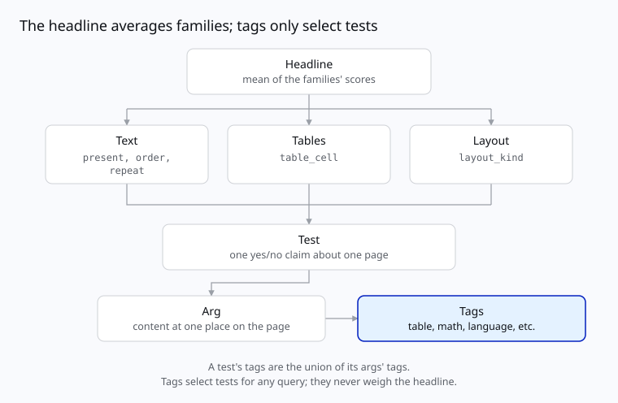
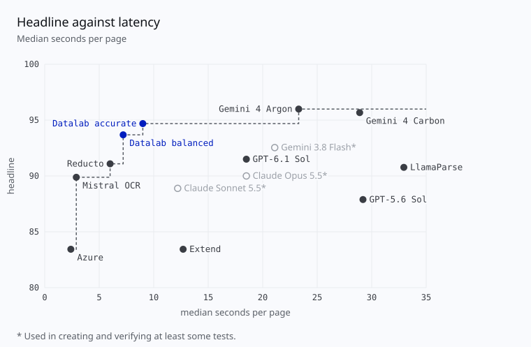
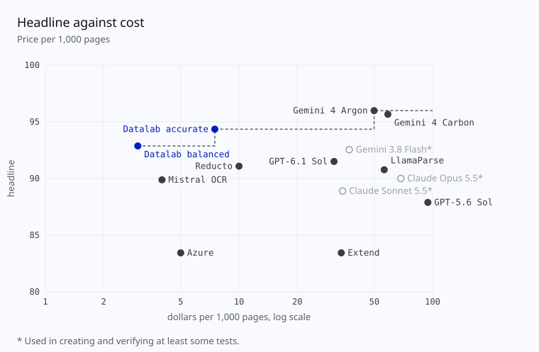

# Omni Parse Bench

[](https://github.com/datalab-to/omni_parse_bench/actions/workflows/test.yml)
[](https://github.com/datalab-to/omni_parse_bench/blob/main/pyproject.toml)
[](https://github.com/datalab-to/omni_parse_bench/blob/main/LICENSE)
[](https://github.com/datalab-to/omni_parse_bench/tree/main/licenses)
[](https://huggingface.co/datasets/datalab-to/omni_parse_bench)

A document-parsing benchmark with 16,288 tests on 2,937 pages. See [Hugging Face](https://huggingface.co/datasets/datalab-to/omni_parse_bench).

## Results

| parser | weights | parameters | headline | USD / 1,000 pages | text | tables | layout | refusals |
| --- | --- | ---: | ---: | ---: | ---: | ---: | ---: | ---: |
| Gemini 4 Argon † | closed |  | 96.0 | $49.88 ‡ | 94.4 | 97.1 | 96.4 | 12 |
| Gemini 4 Carbon † | closed |  | 95.7 | $58.73 ‡ | 94.7 | 97.1 | 95.2 | 5 |
| Datalab accurate | closed |  | 94.7 | $7.50 | 92.6 | 95.4 | 96.0 | — |
| Datalab balanced | closed |  | 93.7 | $3.00 | 90.7 | 94.3 | 96.1 | — |
| Gemini 3.8 Flash * | closed |  | 92.5 | ≈$37.08 | 92.0 | 95.3 | 90.3 | 4 |
| GPT-6.1 Sol § | closed |  | 91.5 | $30.95 | 89.8 | 95.6 | 89.1 | 17 |
| Reducto | closed |  | 91.1 | $10.00 | 86.0 | 91.4 | 95.8 | — |
| LlamaParse | closed |  | 90.8 | ≈$31.25¶ | 89.4 | 92.9 | 90.0 | — |
| chandra-ocr-2 (Datalab) | open | 4.5B | 90.4 | — | 87.9 | 88.0 | 95.4 | — |
| Claude Opus 5.5 * § | closed |  | 90.0 | $68.45 | 93.9 | 93.4 | 82.6 | 40 |
| Mistral OCR | closed |  | 89.9 | $4.00 | 83.6 | 92.2 | 93.8 | — |
| Claude Sonnet 5.5 * | closed |  | 88.9 | ≈$34.30 | 93.7 | 95.5 | 77.5 | 6 |
| dots.mocr | open | 3.0B | 88.2 | — | 83.1 | 89.0 | 92.5 | — |
| GPT-5.6 Sol | closed |  | 87.9 | ≈$94.49 | 86.0 | 91.9 | 85.9 | 17 |
| MinerU2.5-Pro | open | 1.2B | 87.4 | — | 78.0 | 92.5 | 91.7 | — |
| Infinity-Parser2-Pro | open | 35.1B (MoE) | 87.4 | — | 83.9 | 84.6 | 93.5 | — |
| OCRia-1 (+ vendor grounding, Docling Heron) | open | 5.17B (+ Heron detector) | 87.1 | — | 82.7 | 84.9 | 93.8 | — |
| Surya OCR 2.5 (Datalab) | open | 0.69B | 86.3 | — | 84.3 | 78.8 | 95.8 | — |
| OXR-1.0 | open | 1.4B | 85.6 | — | 77.0 | 88.3 | 91.4 | — |
| OvisOCR3 | open | 0.85B | 84.5 | — | 78.2 | 84.7 | 90.6 | — |
| MiniCPM-OCR-1.0 | open | 1.3B | 83.5 | — | 73.4 | 89.5 | 87.6 | — |
| Extend | closed |  | 83.4 | ≈$33.75 | 64.2 | 92.7 | 93.4 | — |
| Azure | closed |  | 83.4 | $5.00 | 75.2 | 82.3 | 92.8 | — |
| Surya OCR 2 (Datalab) | open | 0.67B | 83.3 | — | 81.2 | 74.6 | 94.3 | — |
| LightOnOCR-3-4B | open | 4.5B | 83.1 | — | 84.4 | 70.9 | 94.0 | — |
| Nemotron 3.5 Parse | open | 0.63B | 82.3 | — | 73.7 | 82.7 | 90.5 | — |
| LightOnOCR-3-0.8B | open | 0.85B | 81.9 | — | 81.7 | 72.2 | 91.7 | — |
| GLM-OCR | open | 1.3B | 81.9 | — | 71.6 | 84.7 | 89.3 | — |
| Unlimited-OCR 2 | open | 3.3B | 81.5 | — | 73.0 | 80.0 | 91.6 | — |
| PaddleOCR-VL-1.6 | open | 0.96B | 81.3 | — | 69.2 | 84.0 | 90.7 | — |
| Unlimited-OCR | open | 3.3B | 79.5 | — | 70.7 | 76.6 | 91.1 | — |
| Indra OCR (Datalab) | open | about 17M | 78.8 | — | 68.0 | 75.8 | 92.6 | — |
| Infinity-Parser2-Flash | open | 2.2B | 78.7 | — | 78.8 | 66.8 | 90.4 | — |
| DeepSeek-OCR-2 | open | 3.4B | 75.4 | — | 64.6 | 70.2 | 91.4 | — |
| LiteParse (ocria-nano) | open | n/a | 74.8 | — | 59.4 | 74.1 | 90.9 | — |
| HunyuanOCR-1.5 | open | 1.0B | 68.8 | — | 62.3 | 62.6 | 81.4 | — |
| Docling (formula) | open | ~0.4B | 66.9 | — | 46.4 | 63.8 | 90.6 | — |
| Docling | open | ~0.1B | 64.5 | — | 39.1 | 63.8 | 90.6 | — |
| PyMuPDF4LLM (OCR) | open | n/a | 51.5 | — | 26.5 | 42.1 | 86.0 | — |
| LiteParse (Tesseract) | open | n/a | 42.3 | — | 43.6 | 14.5 | 68.8 | — |
| PyMuPDF4LLM | open | n/a | 41.2 | — | 17.7 | 42.0 | 64.0 | — |
| LiteParse | open | n/a | 35.0 | — | 37.9 | 14.3 | 52.8 | — |
| OpenDataLoader | open | n/a | 23.6 | — | 17.9 | 5.4 | 47.4 | — |
| OvisOCR2 | open | 0.85B | none | — | 74.2 | 79.9 | unsupported | — |
| Xiaomi-OCR-0 | open | 0.87B | none | — | 73.7 | 90.6 | unsupported | — |
| OvisOCR | open | 1.4B | none | — | 72.2 | 78.2 | unsupported | — |
| olmOCR-2 | open | 8.3B | none | — | 71.8 | 56.6 | unsupported | — |
| Nanonets-OCR2-3B | open | 3.8B | none | — | 69.0 | 62.6 | unsupported | — |
| pdf-inspector (OCR) | open | n/a | none | — | 41.4 | 17.7 | unsupported | — |
| pdf-inspector | open | n/a | none | — | 20.6 | 17.0 | unsupported | — |
| pdftext | open | n/a | none | — | 20.6 | 0.0 | unsupported | — |
| pdftotext | open | n/a | none | — | 20.4 | 0.0 | unsupported | — |
| Tesseract | open | n/a | none | — | 17.7 | 0.0 | unsupported | — |
| MarkItDown | open | n/a | none | — | 16.0 | 13.9 | unsupported | — |

Scores use omni-parse-bench 1.7.0: saved predictions are regraded with it, and locally run open tools are fresh full runs (see the next paragraph); rows marked § keep their published 1.5.0 grades.

Rows for open tools run locally (pdftotext, pdftext, MarkItDown, pdf-inspector, PyMuPDF4LLM, OpenDataLoader and LiteParse) are full runs graded with released omni-parse-bench 1.7.0, failed pages counted; settings and failures per tool are in [docs/providers.md](docs/providers.md).

\* Used in creating and verifying at least some tests.

§ Not yet regraded with 1.7.0: these rows keep the scores they were published with (omni-parse-bench 1.5.0).

Gemini 3.8 Flash's and GPT-5.6 Sol's layout scores use a separate run that asked each model for blocks.

† Gemini 4 results combine one full pass with one rerun of every page that pass failed, made with the reader that accepts `bbox` (omni-parse-bench 1.6.0 and later); the full pass's other pages are unchanged. Carbon also has four pages that hit the output-token limit. See [the run notes](docs/gemini4-2026-11-10.md) for the first measurement.

‡ Gemini 4 costs include the original full pass **and** all failed-page reruns, divided by 2,937 pages; separate validation probes are excluded. These cumulative experiment costs are not fresh single-pass prices.

Other vendor prices are historical estimates from the original chart; their dates and tiers have not been re-verified.

¶ As of 2026-11-26, LlamaParse's [pricing page](https://developers.llamaindex.ai/llamaparse/general/pricing) lists Agentic Plus at 25 credits/page. The saved run setting was `tier=agentic_plus`, `version=latest`, with no `layout_extraction` setting; layout blocks were derived from returned `items` retrieved with `expand=markdown,items,usage`. The listed price is therefore ≈$31.25 per 1,000 pages at the Pro rate ($1.25 per 1,000 credits), or $37.50 at the pay-as-you-go rate ($1.50 per 1,000 credits). The score uses saved predictions from runs dated 2026-09-30 and 2026-10-06; it has not been re-measured.

## About the benchmark

This repository contains a way to benchmark document-parsing systems using our unit-test scorer and dataset as well as your own. Concretely, this repository holds:

- the scorer, which works on its own: a page's output and its tests as input, a verdict per test as output;
- the benchmark: run over our dataset on [Hugging Face](https://huggingface.co/datasets/datalab-to/omni_parse_bench), or
  your own; and
- the systems: different registered systems that you can easily evaluate, including open models with a folder to serve each on a GPU.

Contents:

1. [Results](#results): scores, costs and refusal counts;
2. [How scoring works](#how-scoring-works): tests, families, the headline and tags;
3. [Install](#install): the scorer alone, or with the adapters and the dataset;
4. [Run the benchmark](#run-the-benchmark): one system on the dataset, from a config;
5. [Grade](#grade): a run again, or predictions of your own;
6. [Score on your own](#score-on-your-own): the scorer on its own, in code or from the command line;
7. [Predict one page](#predict-one-page): one page through one system;
8. [Results details](#results-details): latency and price charts;
9. [License](#license); and
10. [Citation](#citation).

## How scoring works



A test is a yes/no question about one page. Each test type belongs to one of four families (the first three make the headline):

| test type | checks | family |
|---|---|---|
| `present` | this text, number or equation appears | text |
| `order` | text A comes before text B | text |
| `repeat` | this line appears exactly N times | text |
| `page_near_empty` | a blank page yields at most N non-space characters | text |
| `verbatim` | the text between two anchors is this, verbatim within the test's edit budget, and nothing else | text |
| `no_excess_repeats` | no passage of 16 words is repeated more often than the page prints its words | text |
| `present` with `{"absent": true}` | a known wrong reading (text under a redaction, the next page's first line) is not in the output | text |
| `table_cell` | this cell sits under these headings and beside these neighbors | tables |
| `layout_kind` | the block holding this line is a heading, text or table | layout |
| `format` | this span of text is bold, italic, underlined, struck through, superscript or subscript, and the words around it are not (reported beside the headline) | format |

A family's score is the share of its tests that pass, and the headline is the mean of the three headline family scores. Format is reported separately overall and per suite; a format-only run retains its format-based fallback headline. Format tests may share a page and suite with headline tests, so the page is predicted once.

Each test is tagged by what it checks:

- structure: `table`, `math`, `form` and `multi_column`;
- rendering: `handwriting`, `tiny`, `rotated` and `degraded`;
- role: `heading`, `caption`, `footnote`, `list`, `code`, `figure` and `header_footer`;
- script: ISO 15924 codes (`Latn`, `Hani`, `Deva`, ...); and
- language: ISO 639-3 codes (`eng`, `fra`, `tha`, ...).

Tags never decide whether a test passes, or the headline. They are only for slicing the results, such as the score
on handwriting alone. The full design is [`docs/design.md`](https://github.com/datalab-to/omni_parse_bench/blob/main/docs/design.md).
What each test reads, ignores and penalizes is in the [scoring reference](https://github.com/datalab-to/omni_parse_bench/blob/main/docs/scoring/README.md).
The scorer's own checks, and a certificate of the relations they keep and the deviations that remain, are in
[`tests/metamorphic`](https://github.com/datalab-to/omni_parse_bench/blob/main/tests/metamorphic/README.md).

## Install

```bash
uv pip install omni-parse-bench                 # the scorer, and grading a dataset folder on disk
uv pip install 'omni-parse-bench[harness]'      # + the adapters, to get predictions
uv pip install 'omni-parse-bench[benchmark]'    # + the Hugging Face client, to download our dataset
```

## Run the benchmark

A run is one system on one dataset. It works in three stages:

1. Plan: check the config, the system's keys and the dataset's files before any call;
2. Predict: send each page to the system and save each answer in the run's folder; and
3. Grade: score the saved answers. Grading calls no system, so it can be done again for free.

### A config

A run is one config: a YAML file with every key written out. `opb init` writes one for a registered system, every
option at its default, and on our dataset:

```bash
opb init datalab > datalab.yaml
```

```yaml
dataset: hf://datasets/datalab-to/omni_parse_bench   # a folder, or a Hugging Face dataset
manifest: manifest.parquet                           # which of its pages, with which files
scorers:
  unit_tests: {}
rows:
  sample: 0
  limit: 0
  only: null
timeout: 900.0           # seconds
workers: 0               # pages in flight at once; 0 for the system's default
system:
  datalab:
    mode: accurate
    ...
```

`opb systems` lists every system you can run; `opb systems <name>` shows its options and the key it needs.

`--set path=value` changes one value the file has, read as YAML, and refuses a path it hasn't. This runs Datalab
on 5 pages:

```bash
export DATALAB_API_KEY=...
opb run --config datalab.yaml --set rows.sample=5 --out runs/
```

`opb run` shows the plan and asks before calling any system.

### Models you serve

Each open model has a folder, `omni_parse_bench/harness/providers/serve/<model>/`, that serves it on any GPU host:

```bash
docker build -t opb-chandra-ocr omni_parse_bench/harness/providers/serve/chandra-ocr
docker run --gpus all -p 8001:8001 opb-chandra-ocr
opb init chandra-ocr > chandra.yaml
opb run --config chandra.yaml --set system.chandra-ocr.base_url=http://<host>:8001
```

The system's `served` option names the weights and their revision. Before any call, opb asks the server what it
serves, and refuses a run whose server serves something else.
[`docs/providers.md`](https://github.com/datalab-to/omni_parse_bench/blob/main/docs/providers.md#serving-an-open-model)
has more information.

### Run folder shape

```
runs/datalab-20261026-185915-9c9e/
  config.yaml                         # resolved config; point to this to rerun
  settings.json                       # the question it answers and the launch; resume checks against it
  server.json                         # for a model you serve: what its server said it serves
  records/<id>.json                   # response from the system in full (cost, raw response)
  predictions/<id>.json               # prediction portion of the response
  unit_tests/summary.json             # summary of scores
  unit_tests/scores.jsonl             # scores (line-per-page)
  unit_tests/details/<id>.jsonl       # detailed info (verdict per test) per page
```

[`docs/API.md`](https://github.com/datalab-to/omni_parse_bench/blob/main/docs/API.md) has more information,
including [how to run on your own dataset](https://github.com/datalab-to/omni_parse_bench/blob/main/docs/API.md#the-dataset).

### Resume

You can resume a run by giving a path to its folder.

```bash
opb resume runs/<run>                                         # continue where it stopped
opb resume runs/<run> --retry-failed                          # also ask again for timeouts, etc.
opb resume runs/<run> --retry-failed --set timeout=1800       # increase timeout
```

## Grade

`opb run` grades its run when it finishes. To grade a run again, or a folder of your own predictions:

```bash
opb grade runs/datalab-20261021-160012-3f9a        # a run knows its own dataset
opb grade mine/ --dataset my-dataset/              # your predictions on your own dataset
```

A summary looks like this:

```json
{
  "scorer": "unit_tests",
  "run": "datalab-20261021-160012-3f9a",
  "rows": 5,
  "failed": {"system": 1, "unusable": 0, "no_answer": 0, "not_scored": 0},
  "coverage": 0.8,
  "headline": 0.657,
  "headline_is": "score",
  "score": 0.657,
  "families": {
    "text": {"score": 0.72, "tests": 120, "documents": 5},
    "tables": {"score": 0.59, "tests": 40, "documents": 3},
    "layout": {"score": 0.66, "tests": 30, "documents": 5}
  }
}
```

A failed page counts with all its tests failed (`UnitTests.score_failure`), in the headline and in each family. `failed`
says why pages failed, and `coverage` is the share of pages scored.

## Score on your own

The scorer works on its own, with no dataset and no network. Here is one page with three tests:

```python
from omni_parse_bench import data
from omni_parse_bench.scorers import unit_tests

tests = unit_tests.tests.parse("example-p1", {"tests": [
    {
        "id": "t1",
        "test_type": "present",
        "output_type": "html",
        "derivation": "text_layer",
        "tags": ["Latn", "eng"],
        "args": {"content": {"text": "Quarterly revenue rose 12%", "max_diffs": 1}},
        "settings": {},
    },
    {
        "id": "t2",
        "test_type": "order",
        "output_type": "html",
        "derivation": "text_layer",
        "tags": ["Latn", "eng", "heading"],
        "args": {
            "before": {"text": "Summary", "max_diffs": 0},
            "after": {"text": "Outlook", "max_diffs": 0},
        },
        "settings": {},
    },
    {
        "id": "t3",
        "test_type": "table_cell",
        "output_type": "html",
        "derivation": "publisher_markup",
        "tags": ["table"],
        "args": {
            "cell": {"text": "4.2", "max_diffs": 0},
            "top_heading": {"text": "Q3", "max_diffs": 0},
        },
        "settings": {},
    },
]})

pred = {
    "html": (
        "<h2>Summary</h2>"
        "<p>Quarterly revenue rose 12% on the year.</p>"
        "<table>"
        "<tr><th>Q2</th><th>Q3</th></tr>"
        "<tr><td>3.9</td><td>4.1</td></tr>"
        "</table>"
        "<h2>Outlook</h2>"
    ),
}
verdicts = unit_tests.score(pred, tests)
```

```python
>>> verdicts
[Verdict(id='t1', result='pass', why=''),
 Verdict(id='t2', result='pass', why=''),
 Verdict(id='t3', result='fail', why="no cell matching '4.2' in any table")]

>>> page = data.Page("example-p1", "example", "example", "pages/example-p1.pdf", "gold/example-p1.json", ("html",))
>>> lines = unit_tests.lines(verdicts, tests, page)
>>> unit_tests.summarize(lines)
{'score': 0.5, 'families': {'text': {'score': 1.0, 'tests': 2, 'documents': 1},
                               'tables': {'score': 0.0, 'tests': 1, 'documents': 1}}}
>>> unit_tests.summarize([x for x in lines if "table" in x["tags"]])   # one tag: the same summary on a slice
{'score': 0.0, 'families': {'tables': {'score': 0.0, 'tests': 1, 'documents': 1}}}
```

A verdict is `pass` or `fail`, with `why` saying what went wrong.

The same from the command line, which prints the verdicts:

```bash
opb score --pred outputs.json --gold gold/<page_id>.json
```

## Predict one page

With `[harness]` installed, each system is an adapter class. `harness.system` makes one from a system name and its
options and `harness.predict` sends one page under the same rules a run uses (one time budget, retries, failures
recorded) and returns its record:

```python
from pathlib import Path

from omni_parse_bench import harness
from omni_parse_bench.scorers import unit_tests

datalab = harness.system("datalab", {"mode": "accurate"})
record = harness.predict(datalab, harness.Input(Path("pages/<page_id>.pdf"), frozenset({"html", "blocks"})))
record["output"]    # {"pages": [{"html": "...", "blocks": [...]}]}
record["raw"]       # the answer as the system gave it
record["cost"]      # what it cost, its wall time and attempts

unit_tests.score(record["output"]["pages"][0], unit_tests.tests.read("gold/<page_id>.json"))   # one page's outputs
```

```bash
opb predict --system datalab --page pages/<page_id>.pdf --options '{"mode": "accurate"}'
```

## Results details


### Headline versus latency



*Note*: Gemini 4, Opus 5.5 and GPT-6.1 Sol use the full-page recorded wall time: HTML plus layout when requested,
including failed pages and retries, with 32 workers per model, while the other points retain the earlier median of
successful, unretried HTML calls only. These timing definitions differ and are not directly comparable.

### Price per 1,000 pages



### Hard slices


Tests on a page the system refused or failed to answer count as failed. _Not English_ is a test with a language tag other than English.

Each cell is the pass rate over every test carrying that tag, leaving out layout tests, so a parser with no layout output isn't penalised here. A test with several tags counts in each slice, so the slices overlap. The tags are the ones in the dataset (`tags`); the language check reads an ISO 639-3 code, so `eng` is English and any other code is _not English_. The script tags (`Latn`, `Grek`, ...) aren't languages and don't count.

The slices use omni-parse-bench 1.7.0 and the same runs as the results table; rows marked § use their published 1.5.0 results.

| parser | handwriting | math | table | form | multi-column | tiny text | rotated | degraded | not English |
| --- | ---: | ---: | ---: | ---: | ---: | ---: | ---: | ---: | ---: |
| Gemini 4 Argon † | 82.2 | 97.0 | 96.8 | 95.4 | 94.3 | 96.4 | 97.1 | 85.5 | 88.9 |
| Gemini 4 Carbon † | 82.2 | 96.9 | 96.9 | 95.7 | 94.3 | 97.1 | 97.2 | 84.3 | 89.8 |
| Datalab accurate | 79.5 | 93.7 | 95.6 | 94.0 | 92.9 | 95.1 | 95.1 | 82.5 | 88.0 |
| Datalab balanced | 72.4 | 93.0 | 94.4 | 91.0 | 91.5 | 93.5 | 86.5 | 79.1 | 81.6 |
| Gemini 3.8 Flash * | 79.4 | 95.7 | 95.0 | 90.9 | 92.4 | 94.0 | 93.0 | 83.4 | 85.0 |
| GPT-6.1 Sol § | 77.4 | 93.7 | 95.1 | 89.4 | 90.1 | 94.5 | 89.0 | 78.9 | 78.7 |
| Reducto | 66.0 | 94.3 | 91.3 | 88.9 | 87.7 | 92.8 | 82.9 | 77.5 | 59.1 |
| LlamaParse | 76.6 | 92.5 | 92.9 | 83.7 | 91.2 | 88.8 | 91.3 | 81.2 | 84.1 |
| chandra-ocr-2 (Datalab) | 66.9 | 93.6 | 88.0 | 84.0 | 87.8 | 92.4 | 71.0 | 79.1 | 72.6 |
| Claude Opus 5.5 * § | 82.6 | 97.5 | 93.5 | 94.7 | 91.3 | 96.7 | 92.0 | 83.9 | 87.1 |
| Mistral OCR | 63.9 | 90.4 | 91.3 | 84.0 | 82.9 | 69.3 | 88.7 | 64.8 | 73.6 |
| Claude Sonnet 5.5 * | 77.0 | 97.0 | 95.4 | 93.8 | 92.6 | 96.7 | 92.8 | 83.9 | 86.0 |
| dots.mocr | 52.7 | 91.3 | 88.3 | 74.6 | 80.9 | 78.2 | 77.4 | 56.4 | 77.1 |
| GPT-5.6 Sol | 66.9 | 89.8 | 91.7 | 86.0 | 87.5 | 90.8 | 77.2 | 75.0 | 71.8 |
| MinerU2.5-Pro | 36.0 | 91.9 | 91.7 | 81.2 | 79.7 | 87.4 | 84.1 | 56.8 | 43.7 |
| Infinity-Parser2-Pro | 72.1 | 93.5 | 84.6 | 82.7 | 85.9 | 86.4 | 62.7 | 78.2 | 54.2 |
| OCRia-1 (+ vendor grounding, Docling Heron) | 62.5 | 93.7 | 84.7 | 82.7 | 82.7 | 83.3 | 53.7 | 73.2 | 50.4 |
| Surya OCR 2.5 (Datalab) | 52.8 | 91.6 | 79.9 | 82.3 | 80.5 | 86.9 | 55.2 | 57.7 | 72.3 |
| OXR-1.0 | 61.0 | 96.2 | 86.7 | 68.9 | 80.2 | 66.5 | 56.0 | 68.0 | 29.0 |
| OvisOCR3 | 42.7 | 94.0 | 84.8 | 83.7 | 77.7 | 70.4 | 62.3 | 58.0 | 40.8 |
| MiniCPM-OCR-1.0 | 43.7 | 90.1 | 87.9 | 74.3 | 75.6 | 68.8 | 67.3 | 58.4 | 30.9 |
| Extend | 73.7 | 36.3 | 92.9 | 90.3 | 81.0 | 89.9 | 87.9 | 75.0 | 66.2 |
| Azure | 36.0 | 85.6 | 82.0 | 82.0 | 76.6 | 87.9 | 78.9 | 49.8 | 47.5 |
| Surya OCR 2 (Datalab) | 48.1 | 91.7 | 75.3 | 73.6 | 76.1 | 75.6 | 44.9 | 51.2 | 72.5 |
| LightOnOCR-3-4B | 67.6 | 94.6 | 73.1 | 85.7 | 81.1 | 87.3 | 61.2 | 76.8 | 51.8 |
| Nemotron 3.5 Parse | 40.1 | 75.9 | 82.7 | 78.5 | 77.8 | 74.9 | 55.0 | 49.8 | 61.1 |
| LightOnOCR-3-0.8B | 57.4 | 94.4 | 74.0 | 84.7 | 78.1 | 84.0 | 62.6 | 69.3 | 44.9 |
| GLM-OCR | 42.6 | 90.3 | 83.9 | 69.0 | 75.7 | 66.5 | 61.8 | 55.4 | 27.3 |
| Unlimited-OCR 2 | 35.8 | 88.2 | 79.3 | 71.9 | 70.9 | 59.4 | 34.4 | 49.5 | 44.3 |
| PaddleOCR-VL-1.6 | 40.0 | 82.3 | 82.6 | 67.9 | 69.7 | 58.6 | 70.9 | 43.9 | 39.6 |
| Unlimited-OCR | 31.3 | 89.3 | 75.3 | 69.1 | 68.8 | 59.3 | 15.6 | 50.4 | 36.8 |
| Indra OCR (Datalab) | 28.1 | 63.5 | 76.6 | 65.4 | 68.7 | 78.1 | 61.5 | 34.6 | 71.1 |
| Infinity-Parser2-Flash | 63.6 | 93.5 | 67.5 | 75.6 | 77.5 | 73.7 | 33.6 | 71.8 | 41.0 |
| DeepSeek-OCR-2 | 28.5 | 82.0 | 68.9 | 59.6 | 64.3 | 50.6 | 9.6 | 37.0 | 43.0 |
| LiteParse (ocria-nano) | 8.5 | 55.4 | 74.7 | 63.9 | 61.4 | 72.9 | 55.8 | 30.2 | 52.9 |
| HunyuanOCR-1.5 | 40.2 | 67.4 | 63.3 | 58.1 | 65.1 | 53.7 | 45.3 | 50.5 | 42.6 |
| Docling (formula) | 18.6 | 24.2 | 65.3 | 63.2 | 57.4 | 68.5 | 26.4 | 29.1 | 47.0 |
| Docling | 18.6 | 5.1 | 65.3 | 63.2 | 55.7 | 68.5 | 26.4 | 26.6 | 47.0 |
| PyMuPDF4LLM (OCR) | 3.2 | 5.8 | 43.9 | 40.0 | 36.6 | 53.8 | 8.7 | 9.1 | 24.3 |
| LiteParse (Tesseract) | 2.0 | 54.0 | 18.9 | 35.2 | 32.2 | 47.1 | 15.6 | 5.9 | 31.5 |
| PyMuPDF4LLM | 0.1 | 5.7 | 41.9 | 19.2 | 30.0 | 34.3 | 8.7 | 0.5 | 22.0 |
| LiteParse | 0.0 | 54.4 | 17.7 | 19.6 | 27.3 | 34.3 | 15.9 | 0.7 | 30.3 |
| OpenDataLoader | 0.1 | 4.4 | 10.1 | 21.4 | 19.5 | 34.6 | 7.6 | 0.9 | 22.2 |
| OvisOCR2 | 36.6 | 94.0 | 79.9 | 78.9 | 72.5 | 58.2 | 49.9 | 52.5 | 31.0 |
| Xiaomi-OCR-0 | 47.9 | 95.3 | 89.0 | 65.4 | 79.2 | 68.5 | 76.0 | 56.2 | 31.1 |
| OvisOCR | 36.0 | 92.8 | 77.0 | 70.0 | 73.2 | 63.6 | 35.3 | 50.4 | 27.1 |
| olmOCR-2 | 61.2 | 84.9 | 58.7 | 70.3 | 68.6 | 57.5 | 57.7 | 65.5 | 39.5 |
| Nanonets-OCR2-3B | 54.6 | 77.6 | 64.1 | 74.2 | 63.8 | 46.2 | 29.3 | 59.6 | 44.4 |
| pdf-inspector (OCR) | 19.3 | 16.8 | 23.6 | 59.3 | 40.9 | 72.5 | 19.3 | 29.1 | 43.4 |
| pdf-inspector | 0.0 | 12.8 | 19.9 | 17.0 | 22.7 | 33.1 | 19.0 | 0.0 | 26.9 |
| pdftext | 0.0 | 4.5 | 6.0 | 21.1 | 22.2 | 34.6 | 13.4 | 0.9 | 31.5 |
| pdftotext | 0.0 | 4.4 | 6.0 | 20.0 | 21.4 | 33.9 | 14.3 | 0.9 | 33.2 |
| Tesseract | 1.7 | 1.4 | 3.1 | 27.1 | 23.3 | 43.3 | 3.7 | 5.2 | 25.0 |
| MarkItDown | 0.0 | 3.5 | 16.4 | 18.6 | 19.4 | 33.1 | 4.5 | 0.7 | 19.6 |

## License

The code is Apache 2.0: see [`LICENSE`](https://github.com/datalab-to/omni_parse_bench/blob/main/LICENSE), and
[`NOTICE`](https://github.com/datalab-to/omni_parse_bench/blob/main/NOTICE) for the third-party code it includes
(KaTeX, MIT; a rewrite of olmOCR-bench's table parser, Apache 2.0).

The data's licenses are per source. Each source of the pages, its license and the credit it requires are in
[`licenses/`](https://github.com/datalab-to/omni_parse_bench/tree/main/licenses), one file per source. The tests
are CC BY 4.0, except those converted from olmOCR-bench (ODC-BY 1.0) and fr-bench-pdf2md (MIT), and those quoting
Wikipedia on three handwriting pages (CC BY-SA 4.0).

## Citation

```bibtex
@misc{omniparsebench2026,
  title        = {Omni Parse Bench: A Document-Parsing Benchmark},
  author       = {{Datalab}},
  year         = {2026},
  howpublished = {\url{https://github.com/datalab-to/omni_parse_bench}},
}
```

Please also cite the upstream datasets whose pages or tests this benchmark uses; they are listed in
[`licenses/`](https://github.com/datalab-to/omni_parse_bench/tree/main/licenses).
