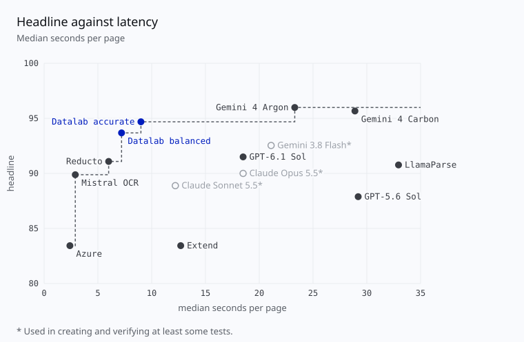
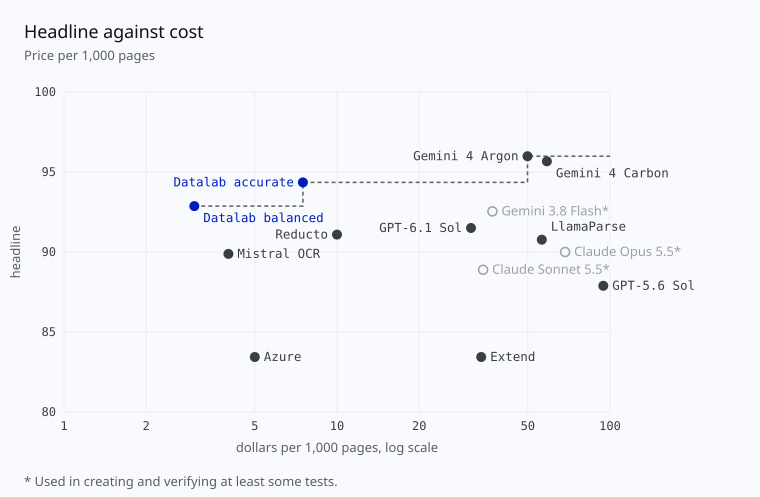

# Leaderboard details

The README shows one comparable table. This page holds the rest: every column, the per-slice scores, the price
chart, and the notes on how each row was run. Scores are percentages on all 2,937 pages. A page the system failed
or refused counts with all its tests failed. Differences under about one point are not meaningful.

Datalab builds this benchmark and has systems on it. Rows for Datalab's systems are marked **(Datalab)**. Every
test, run and verdict is public, so you can check any row.

- [All rows](#all-rows)
- [Run settings and notes per row](#run-settings-and-notes-per-row)
- [Headline versus latency](#headline-versus-latency)
- [Price per 1,000 pages](#price-per-1000-pages)
- [Hard slices](#hard-slices)
- [Correct a row](#correct-a-row)

## All rows

Scores use omni-parse-bench 1.8.0 ([release notes](release-notes/v1.8.0.md)). Most rows are saved predictions regraded with
1.7.0, which gives the same numbers under 1.8.0. Fresh runs: Gemini 4, Indra OCR, OCRia-1, Docling, the layout of
Gemini 3.8 Flash and GPT-5.6 Sol, and the open rows run locally (pdftotext, pdftext, MarkItDown, pdf-inspector, PyMuPDF4LLM, OpenDataLoader, LiteParse). Rows marked \* are
described in [Starred rows](#starred-rows). Refusals are counted for systems called through an LLM API only; a dash
means not measured, not zero. Parameters are the weights' total; 5.17B for OCRia-1 excludes the Docling Heron layout
detector, and 35.1B for Infinity-Parser2-Pro is a mixture of experts.

| parser | weights | parameters | headline | text | tables | layout | USD / 1,000 pages | refusals |
| --- | --- | ---: | ---: | ---: | ---: | ---: | ---: | ---: |
| Gemini 4 Argon † | closed | — | 96.0 | 94.4 | 97.1 | 96.4 | $49.88 ‡ | 12 |
| Gemini 4 Carbon † | closed | — | 95.7 | 94.7 | 97.1 | 95.2 | $58.73 ‡ | 5 |
| Datalab accurate (Datalab) | closed | — | 94.7 | 92.6 | 95.4 | 96.0 | $7.50 | — |
| Datalab balanced (Datalab) | closed | — | 93.7 | 90.7 | 94.3 | 96.1 | $3.00 | — |
| Gemini 3.8 Flash * | closed | — | 92.5 | 92.0 | 95.3 | 90.3 | ≈$37.08 | 4 |
| Reducto | closed | — | 91.1 | 86.0 | 91.4 | 95.8 | $10.00 | — |
| LlamaParse | closed | — | 90.8 | 89.4 | 92.9 | 90.0 | ≈$31.25 | — |
| chandra-ocr-2 (Datalab) | open | 4.5B | 90.4 | 87.9 | 88.0 | 95.4 | — | — |
| Mistral OCR | closed | — | 89.9 | 83.6 | 92.2 | 93.8 | $4.00 | — |
| Claude Sonnet 5.5 * | closed | — | 88.9 | 93.7 | 95.5 | 77.5 | ≈$34.30 | 6 |
| dots.mocr | open | 3.0B | 88.2 | 83.1 | 89.0 | 92.5 | — | — |
| GPT-5.6 Sol | closed | — | 87.9 | 86.0 | 91.9 | 85.9 | ≈$94.49 | 17 |
| MinerU2.5-Pro | open | 1.2B | 87.4 | 78.0 | 92.5 | 91.7 | — | — |
| Infinity-Parser2-Pro | open | 35.1B | 87.4 | 83.9 | 84.6 | 93.5 | — | — |
| OCRia-1 (+ vendor grounding, Docling Heron) | open | 5.17B | 87.1 | 82.7 | 84.9 | 93.8 | — | — |
| Surya OCR 2.5 (Datalab) | open | 0.69B | 86.3 | 84.3 | 78.8 | 95.8 | — | — |
| OXR-1.0 | open | 1.4B | 85.6 | 77.0 | 88.3 | 91.4 | — | — |
| OvisOCR3 | open | 0.85B | 84.5 | 78.2 | 84.7 | 90.6 | — | — |
| MiniCPM-OCR-1.0 | open | 1.3B | 83.5 | 73.4 | 89.5 | 87.6 | — | — |
| Extend | closed | — | 83.4 | 64.2 | 92.7 | 93.4 | ≈$33.75 | — |
| Azure | closed | — | 83.4 | 75.2 | 82.3 | 92.8 | $5.00 | — |
| Surya OCR 2 (Datalab) | open | 0.67B | 83.3 | 81.2 | 74.6 | 94.3 | — | — |
| LightOnOCR-3-4B | open | 4.5B | 83.1 | 84.4 | 70.9 | 94.0 | — | — |
| Nemotron 3.5 Parse | open | 0.63B | 82.3 | 73.7 | 82.7 | 90.5 | — | — |
| LightOnOCR-3-0.8B | open | 0.85B | 81.9 | 81.7 | 72.2 | 91.7 | — | — |
| GLM-OCR | open | 1.3B | 81.9 | 71.6 | 84.7 | 89.3 | — | — |
| Unlimited-OCR 2 | open | 3.3B | 81.5 | 73.0 | 80.0 | 91.6 | — | — |
| PaddleOCR-VL-1.6 | open | 0.96B | 81.3 | 69.2 | 84.0 | 90.7 | — | — |
| MonkeyOCR | open | 3B | 79.9 | 70.3 | 79.6 | 89.8 | — | — |
| Unlimited-OCR | open | 3.3B | 79.5 | 70.7 | 76.6 | 91.1 | — | — |
| Indra OCR (Datalab) | open | 0.017B | 78.8 | 68.0 | 75.8 | 92.6 | — | — |
| Infinity-Parser2-Flash | open | 2.2B | 78.7 | 78.8 | 66.8 | 90.4 | — | — |
| DeepSeek-OCR-2 | open | 3.4B | 75.4 | 64.6 | 70.2 | 91.4 | — | — |
| LiteParse (ocria-nano) | open | — | 74.8 | 59.4 | 74.1 | 90.9 | — | — |
| HunyuanOCR-1.5 | open | 1.0B | 68.8 | 62.3 | 62.6 | 81.4 | — | — |
| Docling (formula) | open | 0.4B | 66.9 | 46.4 | 63.8 | 90.6 | — | — |
| Docling | open | 0.1B | 64.5 | 39.1 | 63.8 | 90.6 | — | — |
| PyMuPDF4LLM (OCR) | open | — | 51.5 | 26.5 | 42.1 | 86.0 | — | — |
| LiteParse (Tesseract) | open | — | 42.3 | 43.6 | 14.5 | 68.8 | — | — |
| PyMuPDF4LLM | open | — | 41.2 | 17.7 | 42.0 | 64.0 | — | — |
| LiteParse | open | — | 35.0 | 37.9 | 14.3 | 52.8 | — | — |
| OpenDataLoader | open | — | 23.6 | 17.9 | 5.4 | 47.4 | — | — |

### Pending regrade

These two rows keep the scores they were published with, graded by omni-parse-bench 1.5.0, not 1.7.0 or 1.8.0. They
are listed apart because the other rows are not graded the same way. They move into the main table when every row is
regraded together.

| parser | weights | parameters | headline | text | tables | layout | USD / 1,000 pages | refusals |
| --- | --- | ---: | ---: | ---: | ---: | ---: | ---: | ---: |
| GPT-6.1 Sol | closed | — | 91.5 | 89.8 | 95.6 | 89.1 | $30.95 | 17 |
| Claude Opus 5.5 * | closed | — | 90.0 | 93.9 | 93.4 | 82.6 | $68.45 | 40 |

### No layout output (no headline)

These systems return text and tables but no layout blocks, so they have no headline. Their text and table scores are
comparable with the rows above.

| parser | weights | parameters | text | tables | refusals |
| --- | --- | ---: | ---: | ---: | ---: |
| OvisOCR2 | open | 0.85B | 74.2 | 79.9 | — |
| Xiaomi-OCR-0 | open | 0.87B | 73.7 | 90.6 | — |
| OvisOCR | open | 1.4B | 72.2 | 78.2 | — |
| olmOCR-2 | open | 8.3B | 71.8 | 56.6 | — |
| Nanonets-OCR2-3B | open | 3.8B | 69.0 | 62.6 | — |
| pdf-inspector (OCR) | open | — | 41.4 | 17.7 | — |
| pdf-inspector | open | — | 20.6 | 17.0 | — |
| pdftext | open | — | 20.6 | 0.0 | — |
| pdftotext | open | — | 20.4 | 0.0 | — |
| Tesseract | open | — | 17.7 | 0.0 | — |
| MarkItDown | open | — | 16.0 | 13.9 | — |

## Run settings and notes per row

### Starred rows

Gemini 3.8 Flash, Claude Opus 5.5 and Claude Sonnet 5.5 (\*) were among the models used to help build or verify
tests. Of the 8,499 text tests, 1,312 (15%) have a model-derived answer (derivation `model_panel`, 1,210, or `model_review`, 102); the public data does not record which model
worked on which test. All 2,403 layout tests have derivation `model_panel` (see
[building-tests.md](building-tests.md#arg-content-and-derivation-from-the-source)). No table test is model-derived. This may favor the
starred models.

### Gemini 4

Gemini 4 Argon and Carbon (†) combine one full pass with one rerun of every page that pass failed, made with the
reader that accepts `bbox` (omni-parse-bench 1.6.0 and later). No other system got a rerun: its failed pages count as
failed. The first pass alone scores 85.0 (Argon) and 83.7 (Carbon). Carbon also has four pages that hit the output
token limit. The measurements are in [the Gemini 4 notes](gemini4-2026-11-10.md). A single retry policy for every
system is planned for the next regrade.

### Layout for two models

The layout scores of Gemini 3.8 Flash and GPT-5.6 Sol come from a separate run that asked each model for blocks.

### Settings

Settings and failures for every row, commercial and open, are in [providers.md](providers.md).

## Headline versus latency

Gemini 4, Opus 5.5 and GPT-6.1 Sol use the full-page recorded wall time: HTML plus layout when requested, including
failed pages and retries. The other points use the earlier median of successful, unretried HTML calls only. The two
definitions are not directly comparable, so read the chart as a rough guide.

## Price per 1,000 pages

The price is the list price in US dollars for one pass over 1,000 pages. Open models run on your own hardware, so
they have no price here. A `≈` marks an estimate, not a billed amount. Estimates have not all been re-checked, and their dates and
tiers are not recorded here.

- ‡ Gemini 4 Argon and Carbon: the reported cost of the run, including the full pass and every rerun, divided by
  2,937 pages. It is not a single-pass price, so these two are not comparable with the other rows.
- LlamaParse: as of 2026-11-26, the [pricing page](https://developers.llamaindex.ai/llamaparse/general/pricing)
  lists Agentic Plus at 25 credits per page, which is ≈$31.25 per 1,000 pages at the Pro rate ($1.25 per 1,000
  credits) or $37.50 at the pay-as-you-go rate ($1.50 per 1,000 credits). The row's score uses saved predictions
  from runs dated 2026-09-30 and 2026-10-06, with `tier=agentic_plus` and `version=latest`.

Hollow points are the starred rows described above. Gemini 4's points use the ‡ cost.

## Hard slices

Each cell is the pass rate over every test carrying that tag, leaving out layout tests, so a parser with no layout
output isn't penalized here. A test with several tags counts in each slice, so the slices overlap. The tags are the
ones in the dataset (`tags`); the language check reads an ISO 639-3 code, so `eng` is English and any other code is
_not English_. The script tags (`Latn`, `Grek`, ...) aren't languages and don't count. Tests on a page the system
refused or failed to answer count as failed.

The slices use omni-parse-bench 1.8.0 and the same runs as the table above; Claude Opus 5.5 and GPT-6.1 Sol use
their published 1.5.0 results. Rows follow the order of the tables above.

| parser | handwriting | math | table | form | multi-column | tiny text | rotated | degraded | not English |
| --- | ---: | ---: | ---: | ---: | ---: | ---: | ---: | ---: | ---: |
| Gemini 4 Argon † | 82.2 | 97.0 | 96.8 | 95.4 | 94.3 | 96.4 | 97.1 | 85.5 | 88.9 |
| Gemini 4 Carbon † | 82.2 | 96.9 | 96.9 | 95.7 | 94.3 | 97.1 | 97.2 | 84.3 | 89.8 |
| Datalab accurate (Datalab) | 79.5 | 93.7 | 95.6 | 94.0 | 92.9 | 95.1 | 95.1 | 82.5 | 88.0 |
| Datalab balanced (Datalab) | 72.4 | 93.0 | 94.4 | 91.0 | 91.5 | 93.5 | 86.5 | 79.1 | 81.6 |
| Gemini 3.8 Flash * | 79.4 | 95.7 | 95.0 | 90.9 | 92.4 | 94.0 | 93.0 | 83.4 | 85.0 |
| Reducto | 66.0 | 94.3 | 91.3 | 88.9 | 87.7 | 92.8 | 82.9 | 77.5 | 59.1 |
| LlamaParse | 76.6 | 92.5 | 92.9 | 83.7 | 91.2 | 88.8 | 91.3 | 81.2 | 84.1 |
| chandra-ocr-2 (Datalab) | 66.9 | 93.6 | 88.0 | 84.0 | 87.8 | 92.4 | 71.0 | 79.1 | 72.6 |
| Mistral OCR | 63.9 | 90.4 | 91.3 | 84.0 | 82.9 | 69.3 | 88.7 | 64.8 | 73.6 |
| Claude Sonnet 5.5 * | 77.0 | 97.0 | 95.4 | 93.8 | 92.6 | 96.7 | 92.8 | 83.9 | 86.0 |
| dots.mocr | 52.7 | 91.3 | 88.3 | 74.6 | 80.9 | 78.2 | 77.4 | 56.4 | 77.1 |
| GPT-5.6 Sol | 66.9 | 89.8 | 91.7 | 86.0 | 87.5 | 90.8 | 77.2 | 75.0 | 71.8 |
| MinerU2.5-Pro | 36.0 | 91.9 | 91.7 | 81.2 | 79.7 | 87.4 | 84.1 | 56.8 | 43.7 |
| Infinity-Parser2-Pro | 72.1 | 93.5 | 84.6 | 82.7 | 85.9 | 86.4 | 62.7 | 78.2 | 54.2 |
| OCRia-1 (+ vendor grounding, Docling Heron) | 62.5 | 93.7 | 84.7 | 82.7 | 82.7 | 83.3 | 53.7 | 73.2 | 50.4 |
| Surya OCR 2.5 (Datalab) | 52.8 | 91.6 | 79.9 | 82.3 | 80.5 | 86.9 | 55.2 | 57.7 | 72.3 |
| OXR-1.0 | 61.0 | 96.2 | 86.7 | 68.9 | 80.2 | 66.5 | 56.0 | 68.0 | 29.0 |
| OvisOCR3 | 42.7 | 94.0 | 84.8 | 83.7 | 77.7 | 70.4 | 62.3 | 58.0 | 40.8 |
| MiniCPM-OCR-1.0 | 43.7 | 90.1 | 87.9 | 74.3 | 75.6 | 68.8 | 67.3 | 58.4 | 30.9 |
| Extend | 73.7 | 36.3 | 92.9 | 90.3 | 81.0 | 89.9 | 87.9 | 75.0 | 66.2 |
| Azure | 36.0 | 85.6 | 82.0 | 82.0 | 76.6 | 87.9 | 78.9 | 49.8 | 47.5 |
| Surya OCR 2 (Datalab) | 48.1 | 91.7 | 75.3 | 73.6 | 76.1 | 75.6 | 44.9 | 51.2 | 72.5 |
| LightOnOCR-3-4B | 67.6 | 94.6 | 73.1 | 85.7 | 81.1 | 87.3 | 61.2 | 76.8 | 51.8 |
| Nemotron 3.5 Parse | 40.1 | 75.9 | 82.7 | 78.5 | 77.8 | 74.9 | 55.0 | 49.8 | 61.1 |
| LightOnOCR-3-0.8B | 57.4 | 94.4 | 74.0 | 84.7 | 78.1 | 84.0 | 62.6 | 69.3 | 44.9 |
| GLM-OCR | 42.6 | 90.3 | 83.9 | 69.0 | 75.7 | 66.5 | 61.8 | 55.4 | 27.3 |
| Unlimited-OCR 2 | 35.8 | 88.2 | 79.3 | 71.9 | 70.9 | 59.4 | 34.4 | 49.5 | 44.3 |
| PaddleOCR-VL-1.6 | 40.0 | 82.3 | 82.6 | 67.9 | 69.7 | 58.6 | 70.9 | 43.9 | 39.6 |
| MonkeyOCR | 45.7 | 91.0 | 78.7 | 64.1 | 73.5 | 66.2 | 48.3 | 53.9 | 22.7 |
| Unlimited-OCR | 31.3 | 89.3 | 75.3 | 69.1 | 68.8 | 59.3 | 15.6 | 50.4 | 36.8 |
| Indra OCR (Datalab) | 28.1 | 63.5 | 76.6 | 65.4 | 68.7 | 78.1 | 61.5 | 34.6 | 71.1 |
| Infinity-Parser2-Flash | 63.6 | 93.5 | 67.5 | 75.6 | 77.5 | 73.7 | 33.6 | 71.8 | 41.0 |
| DeepSeek-OCR-2 | 28.5 | 82.0 | 68.9 | 59.6 | 64.3 | 50.6 | 9.6 | 37.0 | 43.0 |
| LiteParse (ocria-nano) | 8.5 | 55.4 | 74.7 | 63.9 | 61.4 | 72.9 | 55.8 | 30.2 | 52.9 |
| HunyuanOCR-1.5 | 40.2 | 67.4 | 63.3 | 58.1 | 65.1 | 53.7 | 45.3 | 50.5 | 42.6 |
| Docling (formula) | 18.6 | 24.2 | 65.3 | 63.2 | 57.4 | 68.5 | 26.4 | 29.1 | 47.0 |
| Docling | 18.6 | 5.1 | 65.3 | 63.2 | 55.7 | 68.5 | 26.4 | 26.6 | 47.0 |
| PyMuPDF4LLM (OCR) | 3.2 | 5.8 | 43.9 | 40.0 | 36.6 | 53.8 | 8.7 | 9.1 | 24.3 |
| LiteParse (Tesseract) | 2.0 | 54.0 | 18.9 | 35.2 | 32.2 | 47.1 | 15.6 | 5.9 | 31.5 |
| PyMuPDF4LLM | 0.1 | 5.7 | 41.9 | 19.2 | 30.0 | 34.3 | 8.7 | 0.5 | 22.0 |
| LiteParse | 0.0 | 54.4 | 17.7 | 19.6 | 27.3 | 34.3 | 15.9 | 0.7 | 30.3 |
| OpenDataLoader | 0.1 | 4.4 | 10.1 | 21.4 | 19.5 | 34.6 | 7.6 | 0.9 | 22.2 |
| GPT-6.1 Sol | 77.4 | 93.7 | 95.1 | 89.4 | 90.1 | 94.5 | 89.0 | 78.9 | 78.7 |
| Claude Opus 5.5 * | 82.6 | 97.5 | 93.5 | 94.7 | 91.3 | 96.7 | 92.0 | 83.9 | 87.1 |
| OvisOCR2 | 36.6 | 94.0 | 79.9 | 78.9 | 72.5 | 58.2 | 49.9 | 52.5 | 31.0 |
| Xiaomi-OCR-0 | 47.9 | 95.3 | 89.0 | 65.4 | 79.2 | 68.5 | 76.0 | 56.2 | 31.1 |
| OvisOCR | 36.0 | 92.8 | 77.0 | 70.0 | 73.2 | 63.6 | 35.3 | 50.4 | 27.1 |
| olmOCR-2 | 61.2 | 84.9 | 58.7 | 70.3 | 68.6 | 57.5 | 57.7 | 65.5 | 39.5 |
| Nanonets-OCR2-3B | 54.6 | 77.6 | 64.1 | 74.2 | 63.8 | 46.2 | 29.3 | 59.6 | 44.4 |
| pdf-inspector (OCR) | 19.3 | 16.8 | 23.6 | 59.3 | 40.9 | 72.5 | 19.3 | 29.1 | 43.4 |
| pdf-inspector | 0.0 | 12.8 | 19.9 | 17.0 | 22.7 | 33.1 | 19.0 | 0.0 | 26.9 |
| pdftext | 0.0 | 4.5 | 6.0 | 21.1 | 22.2 | 34.6 | 13.4 | 0.9 | 31.5 |
| pdftotext | 0.0 | 4.4 | 6.0 | 20.0 | 21.4 | 33.9 | 14.3 | 0.9 | 33.2 |
| Tesseract | 1.7 | 1.4 | 3.1 | 27.1 | 23.3 | 43.3 | 3.7 | 5.2 | 25.0 |
| MarkItDown | 0.0 | 3.5 | 16.4 | 18.6 | 19.4 | 33.1 | 4.5 | 0.7 | 19.6 |

## Correct a row

Vendors and authors: open an issue to correct your system's settings or price, or to request a rerun. See
[CONTRIBUTING.md](../CONTRIBUTING.md).
