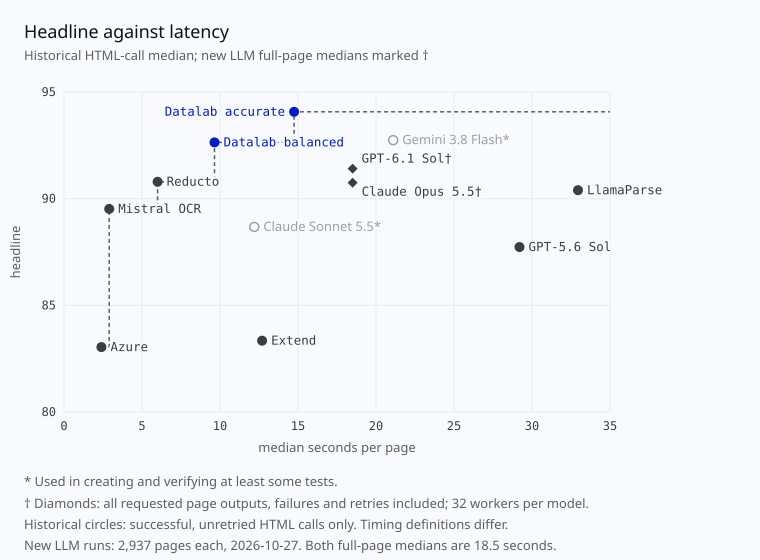
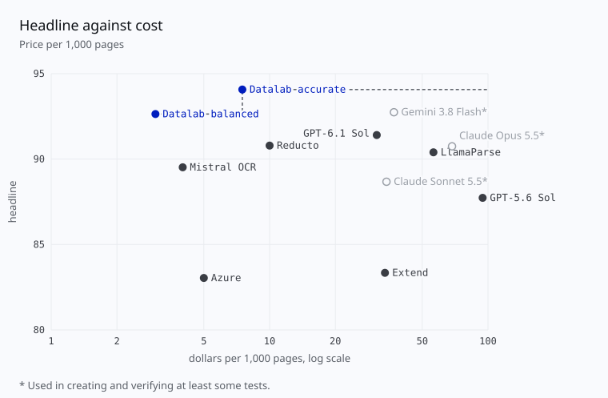

# Results

Every system's score on the published dataset, `hf://datasets/datalab-to/omni_parse_bench` (16,288 tests on 2,937 pages).

## Headline and families

The headline is the mean of three family scores: text (`present`, `order` and `repeat` tests), tables
(`table_cell`) and layout (`layout_kind`). A system that returns no layout has no headline.

| parser | weights | parameters | headline | USD / 1,000 pages | text | tables | layout | refusals |
| --- | --- | ---: | ---: | ---: | ---: | ---: | ---: | ---: |
| **Datalab accurate** | closed |  | 94.1 | $7.50 | 92.0 | 94.2 | 96.0 | — |
| Gemini 3.8 Flash* | closed |  | 92.9 | ≈$37.08 | 91.3 | 95.2 | 92.2 | 8 |
| **Datalab balanced** | closed |  | 92.6 | $3.00 | 90.1 | 91.6 | 96.2 | — |
| GPT-6.1 Sol | closed |  | 91.5 | $30.95 | 89.8 | 95.6 | 89.1 | 17 |
| Reducto | closed |  | 90.8 | $10.00 | 85.4 | 91.2 | 95.8 | — |
| LlamaParse | closed |  | 90.4 | ≈$56.25 | 88.2 | 92.6 | 90.4 | — |
| **chandra-ocr-2** | open | 4.5B | 90.1 | — | 87.4 | 87.4 | 95.4 | — |
| Claude Opus 5.5 | closed |  | 90.0 | $68.45‡ | 93.9 | 93.4 | 82.6 | 40 |
| Mistral OCR | closed |  | 89.5 | $4.00 | 82.8 | 91.9 | 93.8 | — |
| Claude Sonnet 5.5* | closed |  | 88.7 | ≈$34.30 | 93.1 | 95.4 | 77.5 | 7 |
| dots.mocr | open | 3.0B | 87.9 | — | 82.5 | 88.6 | 92.5 | — |
| GPT-5.6 Sol | closed |  | 87.8 | ≈$94.49 | 85.4 | 91.6 | 86.5 | 17 |
| MinerU2.5-Pro | open | 1.2B | 87.1 | — | 77.4 | 92.1 | 91.7 | — |
| Infinity-Parser2-Pro | open | 35.1B (MoE) | 87.0 | — | 83.3 | 84.1 | 93.5 | — |
| **Surya OCR 2.5** | open | 0.69B | 85.9 | — | 83.8 | 78.3 | 95.7 | — |
| OXR-1.0 | open | 1.4B | 85.3 | — | 76.4 | 88.2 | 91.4 | — |
| Extend | closed |  | 83.3 | ≈$33.75 | 64.1 | 92.5 | 93.4 | — |
| MiniCPM-OCR-1.0 | open | 1.3B | 83.2 | — | 72.8 | 89.1 | 87.6 | — |
| **Surya OCR 2** | open | 0.67B | 83.1 | — | 80.6 | 74.3 | 94.3 | — |
| Azure | closed |  | 83.0 | $5.00 | 74.6 | 81.7 | 92.8 | — |
| LightOnOCR-3-4B | open | 4.5B | 82.9 | — | 83.9 | 70.8 | 94.0 | — |
| LightOnOCR-3-0.8B | open | 0.85B | 81.6 | — | 81.1 | 72.1 | 91.7 | — |
| GLM-OCR | open | 1.3B | 81.5 | — | 71.0 | 84.2 | 89.3 | — |
| Unlimited-OCR 2 | open | 3.3B | 81.2 | — | 72.4 | 79.7 | 91.6 | — |
| Nemotron 3.5 Parse | open | 0.63B | 80.0 | — | 72.4 | 77.3 | 90.2 | — |
| Unlimited-OCR | open | 3.3B | 79.3 | — | 70.2 | 76.5 | 91.1 | — |
| PaddleOCR-VL-1.6 | open | 0.96B | 78.7 | — | 61.7 | 83.7 | 90.7 | — |
| Infinity-Parser2-Flash | open | 2.2B | 78.4 | — | 78.4 | 66.5 | 90.4 | — |
| DeepSeek-OCR-2 | open | 3.4B | 75.2 | — | 64.2 | 70.0 | 91.4 | — |
| **Indra OCR** | open | about 12M † | 69.5 | — | 60.3 | 58.1 | 90.1 | — |
| HunyuanOCR-1.5 | open | 1.0B | 64.6 | — | 50.5 | 61.9 | 81.4 | — |
| olmOCR-2 | open | 8.3B | none | — | 71.3 | 56.6 | unsupported | — |
| Nanonets-OCR2-3B | open | 3.8B | none | — | 68.2 | 62.6 | unsupported | — |
| Tesseract | open | n/a | none | — | 17.6 | 0.0 | unsupported | — |

Costs are USD per 1,000 pages. Opus 5.5 and GPT-6.1 Sol use the measured full-run reported costs.
‡ Opus is a reported subtotal: 12 refused pages returned no usage or cost. Historical prices retain the
existing price chart’s 2026-10-08 basis; `≈` marks values read back from that chart rather than remeasured.
Datalab prices include the chart’s 25% data-retention discount. `—` means self-hosted inference cost was
not measured; it does not mean free inference.

\* Used in creating and verifying at least some tests. Datalab's own systems are in bold.

Refusals count distinct pages with at least one required output refused by the provider, including content
filtering and Gemini's `RECITATION` stop; `—` means not audited, rather than zero. Gemini has 8 refusals and 12
other failed pages; Sonnet 5.5 has 7 refusals and 3 other failed pages. GPT-5.6 Sol has 17 refusals; Opus 5.5
has 40; GPT-6.1 Sol has 17, with no other failed pages in those three runs.

Opus 5.5 and GPT-6.1 Sol were each run once on 2026-10-27 using omni-parse-bench 1.0.0, the stock OpenRouter
adapter and each model's default reasoning. The three earlier LLM rows were recomputed from their published
verdicts and archived failure records, without new inference or changes to the
tests. [Machine-readable LLM run summaries](./llm-run-summaries.json) give the exact scores, denominators and
failed/refused page IDs.

Parameters are those used at inference, counted from each model's weight files: an output layer tied to the
embeddings counts once, and multi-token-prediction heads are left out. † Indra OCR's is the total of its
published weights with its math models, read from the dataset card's parameters chart; its own
documentation gives 7.3M for its default models without math.

Open-weight models are served from their folders in `omni_parse_bench/harness/providers/serve/`, with the
defaults each vendor recommends; each adapter's docstring lists where it differs. A model whose vendor code
reads PDFs gets the page file and renders it as its vendor does; a model whose vendor code takes images only
(HunyuanOCR, Nanonets-OCR2, Nemotron 3.5 Parse) gets the page as a PNG at most 2,048 px on its long edge.

### Headline versus latency

The new LLM points († diamonds) use the full-page recorded wall time: HTML plus layout when requested,
including failed pages and retries, with 32 workers per model. Both medians are 18.5 seconds; p90 is
37.3 seconds for Opus 5.5 and 43.1 seconds for GPT-6.1 Sol. Historical circles retain the earlier median of
successful, unretried HTML calls only. These timing definitions differ and are not directly comparable.

### Price per 1,000 pages

| Model | Headline | Reported USD / 1,000 pages | Refusals |
| --- | ---: | ---: | ---: |
| Claude Opus 5.5 | 90.00 | $68.45† | 40 |
| GPT-6.1 Sol | 91.50 | $30.95 | 17 |

One full run per model, 2,937 pages each. Prices include all page outputs requested by the benchmark and
response-reported upstream model charges under OpenRouter BYOK. † Opus's price is a reported subtotal:
12 refused pages returned no usage or cost. The earlier systems' chart prices are unchanged.

## Hard slices

Each tag's score is the mean of the family scores on the tests with that tag
(for a system with no layout, the mean of the families it has). A test with several tags counts in each.
As in the headline, a failed page's tests count as failed. Tests per tag: handwriting 923, math 3,316, table 6,767, form 1,028, multi-column 3,517, tiny text 832, rotated 824, degraded 655, not English 1,950. _Not English_ is a test with a language tag other than English.

| parser | handwriting | math | table | form | multi-column | tiny text | rotated | degraded | not English |
| --- | ---: | ---: | ---: | ---: | ---: | ---: | ---: | ---: | ---: |
| **Datalab accurate** | 76.7 | 98.0 | 95.6 | 84.3 | 94.9 | 90.5 | 95.1 | 89.7 | 83.0 |
| Gemini 3.8 Flash* | 79.4 | 98.3 | 93.8 | 85.0 | 92.3 | 88.5 | 92.5 | 85.4 | 83.8 |
| **Datalab balanced** | 65.7 | 97.0 | 94.2 | 78.5 | 92.7 | 90.8 | 88.1 | 87.4 | 77.1 |
| Reducto | 67.3 | 97.9 | 92.7 | 79.8 | 91.3 | 88.6 | 88.8 | 85.8 | 71.3 |
| LlamaParse | 64.2 | 86.7 | 93.7 | 79.1 | 91.4 | 86.2 | 92.6 | 77.1 | 76.7 |
| **chandra-ocr-2** | 66.8 | 96.1 | 90.7 | 74.6 | 90.4 | 89.1 | 82.2 | 85.9 | 74.6 |
| Mistral OCR | 69.0 | 95.6 | 91.5 | 76.7 | 89.6 | 81.2 | 89.4 | 78.6 | 77.0 |
| Claude Sonnet 5.5* | 69.6 | 93.9 | 92.0 | 77.7 | 86.5 | 90.2 | 93.0 | 87.0 | 78.4 |
| dots.mocr | 58.9 | 96.1 | 89.3 | 68.5 | 86.4 | 81.1 | 83.8 | 71.7 | 74.4 |
| GPT-5.6 Sol | 67.6 | 92.4 | 91.6 | 79.2 | 87.4 | 81.1 | 77.9 | 87.0 | 75.2 |
| MinerU2.5-Pro | 52.0 | 88.0 | 91.9 | 75.9 | 87.5 | 85.1 | 82.3 | 77.6 | 60.4 |
| Infinity-Parser2-Pro | 65.2 | 88.5 | 88.2 | 72.6 | 88.8 | 84.1 | 71.7 | 87.0 | 66.0 |
| **Surya OCR 2.5** | 58.4 | 97.0 | 88.0 | 71.6 | 85.4 | 81.7 | 74.7 | 75.4 | 72.0 |
| OXR-1.0 | 56.9 | 90.2 | 86.9 | 65.0 | 86.8 | 73.9 | 69.5 | 78.1 | 51.5 |
| Extend | 77.0 | 76.6 | 94.7 | 79.9 | 88.3 | 88.2 | 90.4 | 84.8 | 74.2 |
| MiniCPM-OCR-1.0 | 52.8 | 94.0 | 87.8 | 68.9 | 80.7 | 77.6 | 72.5 | 73.0 | 52.6 |
| **Surya OCR 2** | 55.2 | 94.7 | 83.7 | 66.0 | 82.0 | 74.7 | 59.9 | 72.6 | 71.4 |
| Azure | 60.1 | 92.6 | 86.1 | 73.0 | 83.8 | 85.5 | 86.9 | 65.8 | 65.8 |
| LightOnOCR-3-4B | 65.4 | 96.4 | 85.5 | 75.2 | 83.0 | 79.5 | 75.7 | 87.8 | 64.8 |
| LightOnOCR-3-0.8B | 57.1 | 87.1 | 85.2 | 73.0 | 81.6 | 78.4 | 77.1 | 76.8 | 60.2 |
| GLM-OCR | 54.1 | 85.8 | 86.4 | 67.0 | 84.2 | 71.7 | 72.7 | 76.8 | 48.2 |
| Unlimited-OCR 2 | 47.7 | 85.1 | 83.5 | 65.2 | 80.5 | 69.6 | 51.9 | 70.6 | 54.9 |
| Nemotron 3.5 Parse | 51.2 | 92.1 | 83.0 | 67.2 | 82.1 | 72.8 | 61.8 | 72.3 | 61.6 |
| Unlimited-OCR | 43.9 | 95.4 | 79.6 | 64.0 | 79.3 | 67.0 | 36.6 | 65.7 | 51.8 |
| PaddleOCR-VL-1.6 | 52.3 | 85.4 | 84.8 | 63.8 | 79.2 | 72.2 | 77.7 | 68.9 | 52.9 |
| Infinity-Parser2-Flash | 58.1 | 96.9 | 77.3 | 66.5 | 81.7 | 73.3 | 56.8 | 78.7 | 54.5 |
| DeepSeek-OCR-2 | 43.6 | 91.4 | 75.3 | 56.0 | 77.4 | 62.1 | 36.5 | 60.8 | 52.1 |
| **Indra OCR** | 31.0 | 59.7 | 75.1 | 52.4 | 69.6 | 69.3 | 68.8 | 46.2 | 56.5 |
| HunyuanOCR-1.5 | 42.1 | 53.0 | 70.6 | 53.2 | 72.1 | 54.8 | 49.2 | 65.6 | 53.0 |
| olmOCR-2 | 38.5 | 79.7 | 64.7 | 55.6 | 66.2 | 55.0 | 63.6 | 70.4 | 39.0 |
| Nanonets-OCR2-3B | 41.3 | 88.2 | 68.2 | 61.9 | 64.7 | 44.1 | 35.7 | 69.3 | 43.6 |
| Tesseract | 0.8 | 0.8 | 12.7 | 14.4 | 16.0 | 25.8 | 6.1 | 2.7 | 12.3 |

The math slice has 3,271 text tests, 41 layout tests and 4 table tests, so one table test moves it by
several points; read it with that in mind.
